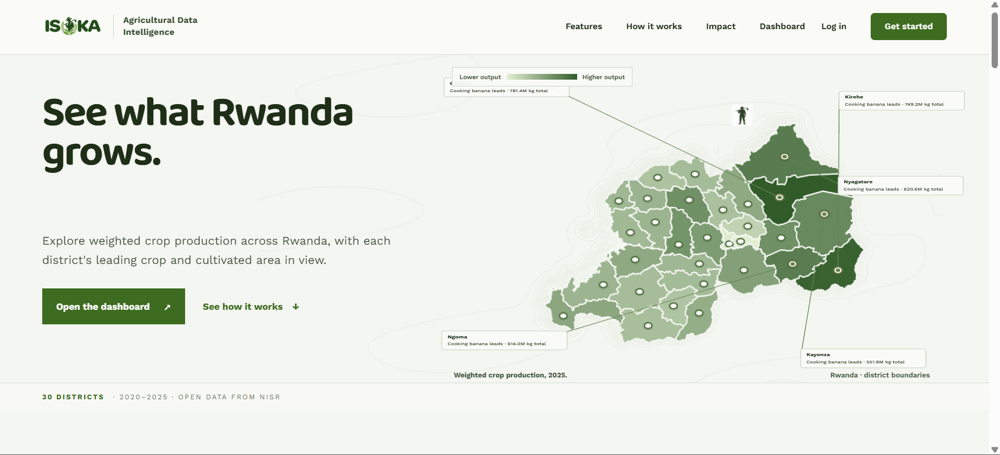
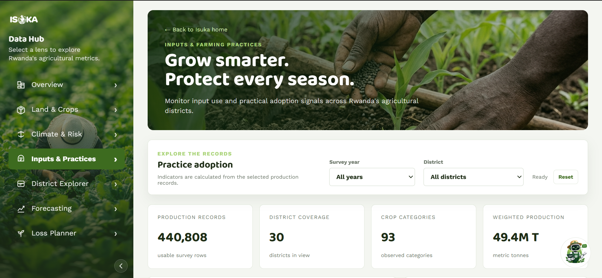
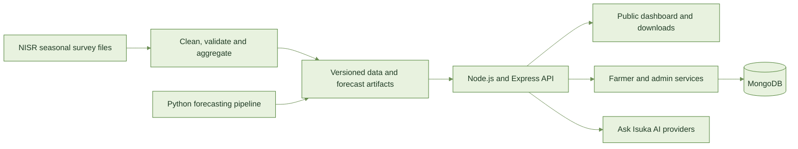

<table align="center">
  <tr>
    <td align="center" valign="middle">
      
    </td>
    <td align="left" valign="middle">
      <h2>Agricultural Data Intelligence<br>for Rwanda</h2>
      <sub>National survey evidence · District-level insight</sub>
    </td>
  </tr>
</table>

<div align="center">

**Know where the harvest goes.**

Turning six years of seasonal agricultural survey data into a clearer picture of production, land use, and reported crop loss across Rwanda.

[🌱 Open the platform](https://isukadataintelligent.vercel.app) · [📊 Explore the dashboard](https://isukadataintelligent.vercel.app/dashboard/) · [▶ Watch the demo on Google Drive](https://drive.google.com/file/d/1ob8TfhxoGgCY-fB-HY1VxDf-pke8hgTw/view?usp=sharing)

</div>

<p align="center">
  <a href="https://drive.google.com/file/d/1ob8TfhxoGgCY-fB-HY1VxDf-pke8hgTw/preview">
    
  </a>
  <br>
  <sub>01 · Landing page and interactive district production map · Click to watch the demo</sub>
</p>

<p align="center">
  <a href="https://drive.google.com/file/d/1ob8TfhxoGgCY-fB-HY1VxDf-pke8hgTw/preview">
    
  </a>
  <br>
  <sub>02 · Inputs &amp; Practices dashboard · Click to watch the demo</sub>
</p>

> **Hackathon review access**
> - Admin: [Open the admin workspace](https://isukadataintelligent.vercel.app/admin/login)
> - Email: `bugingoobed1@gmail.com` · Password: `Bugingo123?`
> - The public dashboard is open without an account. A compressed copy of the demo is included at [`www/DEMO VIDEO-compressed.mp4`](www/DEMO%20VIDEO-compressed.mp4).

---

## 🌾 The idea

Isuka makes Rwanda's National Institute of Statistics (NISR) Seasonal Agricultural Survey easier to explore and use. The platform brings district-level evidence into one place so farmers, researchers, NGOs, and decision-makers can compare seasons, understand recorded losses, and explore practical scenarios.

The name *Isuka* means “hoe”—a familiar tool of Rwandan farming. The product follows the same spirit: make useful agricultural evidence accessible and practical.

## ✨ Explore Isuka

| Experience | What you can do |
| --- | --- |
| **National dashboard** | Filter agricultural indicators by year and district; see overview figures animate as the selection changes. |
| **Land & Crops** | Explore crop production, cultivated area, and yield across districts and seasons. |
| **Climate & Risk** | Compare recorded district loss rates and risk tiers. |
| **Inputs & Practices** | Review improved seed, fertilizer, and irrigation indicators. |
| **District Explorer** | Inspect a district's production, leading crop, area, and reported loss. |
| **Forecasting** | Compare a seasonal baseline, machine-learning estimate, blended outlook, and held-out evaluation. |
| **Loss Recovery Planner** | Explore what-if scenarios for potential harvest recovery when recorded losses fall. |
| **Ask Isuka** | Ask questions about survey findings and farming topics with AI assistance. |
| **Farmer area** | Create an account, maintain farm records, and review alerts and account settings. |
| **Admin workspace** | Manage published agricultural data through an authorized account. |
| **Data Library** | Download cleaned district aggregates by year or as a combined archive. |

## 🗺️ From survey to insight



**Data source:** NISR Seasonal Agricultural Survey, 2020–2025 · **Coverage:** 30 districts · **Seasons:** A, B, and C.

### How figures are prepared

- Survey weights are used where applicable; estimates are not simple counts of respondent rows.
- Question labels help map measures when questionnaires change between seasons.
- Data checks handle duplicate and invalid records; district joins use district codes.
- Missing observations remain missing instead of being silently changed to zero.
- Public downloads contain aggregate district-level data, not individual respondent records.
- Published artifacts carry a calculation version so the application can serve a consistent set of indicators.

### Recorded-loss tiers

| Tier | Recorded district loss rate |
| --- | ---: |
| 🟢 Low | Below 15% |
| 🟡 Moderate | 15% to below 30% |
| 🔴 High | 30% or higher |

## 🔭 Forecasting, with context

The platform presents a one-season-ahead outlook for 2026 Season A using historical survey data. It combines a seasonal statistical baseline with a gradient-boosting model and shows baseline, machine-learning, and blended results with confidence information. Evaluation holds out 2025 data and compares predictions with the corresponding survey observations.

Forecasts are decision-support estimates, not guarantees. Current model inputs do not include rainfall, pests, market prices, or policy changes.

## 🎬 Demo route

Watch the [full project demo on Google Drive](https://drive.google.com/file/d/1ob8TfhxoGgCY-fB-HY1VxDf-pke8hgTw/view?usp=sharing), or open the compressed [repository copy](www/DEMO%20VIDEO-compressed.mp4) in `www/`. For a quick walkthrough:

1. Open the landing page and district map.
2. Explore the dashboard; change the year and district filters.
3. Compare crop, risk, and input indicators across dashboard sections.
4. Open a district in District Explorer.
5. Review the forecast and its held-out evaluation.
6. Try a reduction scenario in Loss Recovery Planner.
7. Download an aggregate from the Data Library and ask Isuka a question.

## ⚖️ Important context

- Survey responses are self-reported and produce weighted estimates from sampled plots, not a census.
- Reported loss is not a complete measure of all food waste.
- District is the finest geographic level available in the published data.
- Some storage indicators have fewer observations than other measures.
- Loss Recovery Planner results are scenarios, not forecasts; currency estimates should be interpreted accordingly.
- SMS alerts and phone verification need an external provider and are not currently connected.
- A new survey season appears after its data artifacts are rebuilt and deployed.

## 🧰 Technology

| Layer | Tools |
| --- | --- |
| Interface and maps | HTML, CSS, JavaScript, Vite, Leaflet |
| API and account services | Node.js, Express, MongoDB |
| Data preparation and forecasting | Python, pandas, scikit-learn |
| AI | Gemini; optional OpenAI provider configuration |
| Email | Resend |
| Hosting | Vercel |

## 🚀 Run locally

### Requirements

- Node.js 22.x
- MongoDB for account features
- Python 3 only when regenerating data or forecasting artifacts

### Install and start

```bash
git clone https://github.com/IGIRANEZA-D/Isuka-data-platform.git
cd Isuka-data-platform
npm install
npm install --prefix backend
npm install --prefix frontend
npm run dev
```

Create the backend environment file for local account and integration features:

```powershell
# Windows PowerShell
Copy-Item backend/.env.example backend/.env
```

```bash
# macOS or Linux
cp backend/.env.example backend/.env
```

The backend reads `backend/.env` locally. Vercel does not read your local `.env`; configure production variables in the Vercel project and redeploy after changing them.

### Common commands

| Command | Purpose |
| --- | --- |
| `npm run dev` | Start the frontend and backend development servers. |
| `npm run build:frontend` | Build the frontend assets. |
| `npm run build:vercel` | Build the Vercel application and verify deployment artifacts. |
| `npm start` | Start the backend server. |
| `npm test` | Run the backend automated tests. |

### Environment configuration

Set only the variables needed by the features you deploy. In Vercel, add production values under the project's **Production** environment. Never commit `.env` files or private API keys.

| Variable | Purpose |
| --- | --- |
| `MONGODB_URI` | MongoDB connection string for accounts and sessions. |
| `MONGODB_DATABASE` | Production database name. |
| `SESSION_SECRET` | Secret used to sign account sessions and tokens. |
| `ADMIN_EMAIL` + `ADMIN_PASSWORD` | Optional pair for provisioning or refreshing the MongoDB admin account. |
| `ADMIN_SEED_PHONE` + `ADMIN_SEED_PASSWORD` | Optional phone-based admin provisioning pair. |
| `GEMINI_API_KEY` | Enables Gemini-powered AI features. |
| `GEMINI_MODEL` | Optional Gemini model override. |
| `OPENAI_API_KEY` | Optional AI provider fallback. |
| `RESEND_API_KEY` + `RESEND_FROM_EMAIL` | Outgoing account email configuration. |
| `PUBLIC_BASE_URL` | Optional canonical URL used in account links. |
| `FRONTEND_ORIGIN` | Optional frontend origin for local or split-host deployments. |
| `PORT` | Optional local server port; defaults to `3000`. |

Deployed admin sign-in checks the admin account stored in MongoDB. The admin variables above are for provisioning or refreshing that database account.

## 🧭 Next steps

- Explore feature-phone access through USSD or SMS with a telecom or aggregator partner.
- Add weather inputs to improve future forecasting.
- Introduce a Kinyarwanda interface reviewed by native speakers.

## 🙏 Acknowledgements

Agricultural data is from the National Institute of Statistics of Rwanda (NISR) Seasonal Agricultural Survey, 2020–2025. Isuka is an independent project and does not represent an official NISR statement. The project uses open-source tools including Node.js, Express, Vite, Leaflet, pandas, and scikit-learn. Typeface families Baloo 2 and Work Sans are distributed under the SIL Open Font License. The project follows the hackathon's stated intellectual-property terms.

---

<div align="center">

**The Ciphers** · *Know where the harvest goes.*

<table>
  <tr>
    <td align="center">
      <br>
      <strong>Obed Bugingo</strong>
    </td>
    <td align="center">
      <br>
      <strong>Niyirora Aphrodise</strong>
    </td>
  </tr>
</table>

</div>
