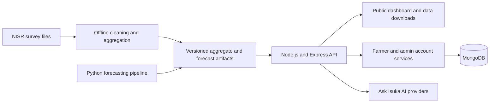

<div align="center">


# Isuka Data Platform

### Know where the harvest goes.

An open agricultural data platform exploring Rwanda's production and recorded post-harvest losses across 30 districts using NISR Seasonal Agricultural Survey data from 2020–2025.

[](https://isukadataintelligent.vercel.app)
[](https://nodejs.org/)
[](https://vercel.com/)

[Dashboard](https://isukadataintelligent.vercel.app/dashboard/) · [Forecasting](https://isukadataintelligent.vercel.app/dashboard/forecasting/) · [Loss Recovery Planner](https://isukadataintelligent.vercel.app/dashboard/loss-planner/) · [Data Library](https://isukadataintelligent.vercel.app/dashboard/forecasting/analysis/)

</div>

---

## Overview

Isuka turns six years of national agricultural survey data into a public, interactive resource for farmers, researchers, NGOs, and decision-makers. Visitors can explore district-level indicators, compare seasons, examine recorded losses, review a tested forecast, and download cleaned aggregate data without creating an account.

The name *Isuka* refers to the hoe, an everyday tool of Rwandan farming. The platform is built around a simple goal: make agricultural evidence easier to explore and use.

## Explore the platform

| Area | What it offers |
| --- | --- |
| **Public dashboard** | National and district indicators, animated overview metrics, season and district filters |
| **Land & Crops** | Crop production, yield, and harvested area across districts and seasons |
| **Climate & Risk** | District views of reported loss and defined risk tiers |
| **Inputs & Practices** | Improved seed, fertilizer, and irrigation indicators; summary figures animate as filters change |
| **District Explorer** | District-level production, leading crop, survey records, area, and loss rate |
| **Forecasting** | A one-season-ahead outlook with confidence ranges and a held-out evaluation |
| **Loss Recovery Planner** | What-if estimates of potential harvest recovery from reducing recorded losses |
| **Ask Isuka** | AI-assisted questions about survey results and farming topics |
| **Farmer area** | Accounts, farm profiles, crop and livestock records, and account tools |
| **Admin workspace** | Dataset administration for authorized administrators |
| **Data Library** | Downloadable cleaned aggregates by year or as a combined archive |

## Data and methodology

The public indicators are built from the National Institute of Statistics of Rwanda (NISR) Seasonal Agricultural Survey for 2020–2025. The period covers three survey seasons (A, B, and C) each year and all 30 districts.

- **Survey-weighted estimates:** figures use survey weights where applicable; they are not simple row counts.
- **Question-label mapping:** fields are identified by question labels to accommodate survey questionnaire changes.
- **Data quality checks:** duplicate and invalid records are handled during processing, and districts are joined using codes.
- **Consistent calculations:** generated artifacts carry a calculation version so the application can serve a coherent set of metrics.
- **Missing values stay missing:** unavailable observations are not silently converted to zero.
- **Aggregate downloads:** the public Data Library contains district-level aggregates, not individual respondent records.

### Risk tiers

Risk tiers are based on recorded district loss rates:

| Tier | Recorded loss rate |
| --- | ---: |
| Low | Below 15% |
| Moderate | 15% to below 30% |
| High | 30% or higher |

## Forecasting

Isuka provides a one-season-ahead forecast for 2026 Season A, based on the available historical survey data. It combines a seasonal statistical baseline with a gradient-boosting model. The forecasting interface exposes the baseline, machine-learning, and blended results, alongside confidence information.

The evaluation holds out 2025 data, generates predictions for that period, and compares them with the corresponding survey observations. Forecasts are decision-support estimates, not guarantees. The current inputs do not include rainfall, pests, market prices, or policy changes.

## Important limitations

- Survey responses are self-reported and represent weighted estimates from sampled plots, not a census.
- Recorded loss reflects what respondents reported; it should not be interpreted as a complete measure of all food waste.
- District is the finest geographic level available in the published data.
- Some storage indicators have fewer observations than other measures.
- Loss Recovery Planner outputs are scenario estimates, not forecasts; currency estimates should be interpreted accordingly.
- SMS alerts and phone verification require an external provider and are not currently connected.
- New survey seasons require a data rebuild and deployment before they appear in the platform.

## Architecture



The dashboards read published data artifacts. MongoDB is used for account and session features; it is not the source of the public survey aggregates.

## Technology

| Component | Technologies |
| --- | --- |
| Frontend | HTML, CSS, JavaScript, Vite, Leaflet |
| API and account services | Node.js, Express, MongoDB |
| Data processing and forecasting | Python, pandas, scikit-learn |
| AI integrations | Gemini, with optional OpenAI configuration |
| Email | Resend |
| Deployment | Vercel |

## Run locally

### Requirements

- Node.js 22.x
- Python 3 only if you need to regenerate forecasting or data artifacts
- MongoDB for account features

### Install and start

```bash
git clone https://github.com/IGIRANEZA-D/Isuka-data-platform.git
cd Isuka-data-platform
npm install
npm install --prefix backend
npm install --prefix frontend
npm run dev
```

Create the backend environment file before starting account services. In PowerShell:

```powershell
Copy-Item backend/.env.example backend/.env
```

On macOS or Linux:

```bash
cp backend/.env.example backend/.env
```

The backend reads `backend/.env` during local development. Vercel does not read your local `.env`; configure environment variables in the Vercel project and redeploy after changing them.

### Common commands

| Command | Purpose |
| --- | --- |
| `npm run dev` | Start the backend and frontend development servers |
| `npm run build:frontend` | Build the frontend assets |
| `npm run build:vercel` | Build the Vercel application and verify required deployment artifacts |
| `npm start` | Start the backend server |
| `npm test` | Run backend automated tests |

### Environment variables

Set only the variables required for the features you are deploying. Add production values in the Vercel project's **Production** environment, and redeploy to apply changes.

| Variable | Purpose |
| --- | --- |
| `MONGODB_URI` | MongoDB connection string for account services |
| `MONGODB_DATABASE` | MongoDB database name; required in production |
| `SESSION_SECRET` | Secret used to sign session and account tokens |
| `ADMIN_EMAIL` and `ADMIN_PASSWORD` | Admin sign-in credentials |
| `ADMIN_SEED_PHONE` and `ADMIN_SEED_PASSWORD` | Optional phone-based admin credential pair |
| `GEMINI_API_KEY` | Enables Gemini-powered AI features |
| `GEMINI_MODEL` | Optional Gemini model override |
| `OPENAI_API_KEY` | Optional AI provider fallback |
| `RESEND_API_KEY` and `RESEND_FROM_EMAIL` | Outgoing account email configuration |
| `PUBLIC_BASE_URL` | Optional canonical public URL for account links |
| `FRONTEND_ORIGIN` | Optional frontend origin for local or split-host deployments |
| `PORT` | Optional local server port (defaults to 3000) |

Never commit `.env` files or private API keys. Vercel environment variables are scoped by deployment environment; production sign-in requires the admin credential pair to be set for **Production**.

## Judge access

The public dashboard does not require an account. Use the following shared hackathon account to review the admin workspace:

| Role | Access |
| --- | --- |
| Visitor | Open the [public dashboard](https://isukadataintelligent.vercel.app/dashboard/) |
| Farmer | Create an account at [/account/signup](https://isukadataintelligent.vercel.app/account/signup) |
| Admin | Visit [/admin/login](https://isukadataintelligent.vercel.app/admin/login) and use the credentials below |

- **Email:** `bugingoobed1@gmail.com`
- **Password:** `Bugingo123?`

Please avoid changing or deleting published datasets during review.

## Five-minute demo

1. Open the landing page and explore the district map.
2. Visit the dashboard and change the year or district filters; overview values animate to the newly filtered data.
3. Open **Inputs & Practices** and filter the view to see its summary metrics update and animate.
4. Select a district in **District Explorer** and review its production and reported loss indicators.
5. Visit **Forecasting** and compare the baseline, machine-learning, and blended results, including the held-out 2025 evaluation.
6. Use the **Loss Recovery Planner** to explore a reduction scenario.
7. Download an aggregate dataset from the **Data Library**.
8. Try **Ask Isuka**, then explore the farmer and admin areas if desired.

## Roadmap

- Feature-phone access through USSD or SMS, subject to a telecom or aggregator partnership.
- Additional weather inputs for forecasting.
- A Kinyarwanda interface reviewed by native speakers.

## Acknowledgements

- Agricultural survey data: National Institute of Statistics of Rwanda (NISR), Seasonal Agricultural Survey, 2020–2025. This is an independent project and does not represent an official NISR statement.
- Open-source technologies include Node.js, Express, Vite, Leaflet, pandas, and scikit-learn.
- Typeface families: Baloo 2 and Work Sans, distributed under the SIL Open Font License.
- The project follows the hackathon's stated intellectual-property terms.

## Team

<div align="center">


**The Ciphers** · *Know where the harvest goes.*

</div>
